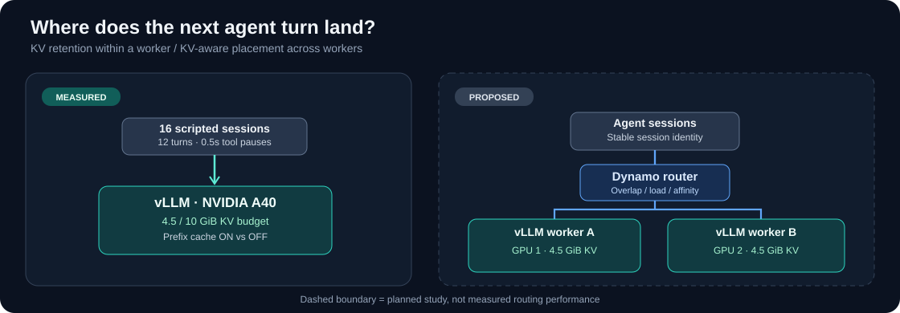

# Agentic Inference Lab

**A reproducible performance investigation of KV-cache reuse, memory pressure, and distributed request placement for multi-turn LLM workloads.**

[Results](#measured-results) · [Method](docs/benchmark-methodology.md) · [Full findings](docs/findings.md) · [Routing experiment](docs/distributed-routing.md) · [Raw measurements](results/2026-10-12-runpod-a40/main/)



## The problem

Agentic LLM serving alternates long-context inference with tool calls and idle periods. Between turns, a paused session's reusable KV blocks compete with other requests for finite GPU memory. Prefix caching is enabled, but **will the prefix still be there when that session resumes?**

This project measures that failure mode on an actual serving runtime, then investigates whether cache-aware placement across replicas can mitigate it. The emphasis is **repeatable experiments and actionable systems behavior**, not a new caching algorithm or a claim of production deployment.

## Measured results

**A40 · vLLM 0.31.0+cu129 · Qwen3-4B-Instruct-2507 · single GPU · 16 synthetic sessions × 12 turns**


| Cache-on, 16-session workload | 4.5 GiB KV | 10 GiB KV |
|:--|--:|--:|
| Median resumed prompt tokens cached | **0.5%** | **98.9%** |
| Median resumed first-content-token latency | **581 ms** | **67 ms** |
| Computed prefill tokens per run | **614,668** | **54,956** |
| Workload wall time | **80.1 s** | **33.7 s** |
| Cache-off control: resumed latency | 591 ms | 567 ms |
| Cache-off control: wall time | 80.3 s | 80.4 s |

Values are medians over **five repetitions of the same deterministic workload** (for prefill tokens, medians of per-run totals). The 4.5 GiB cache-on result showed negligible useful reuse and **no consistent wall-time advantage** over its cache-off control. The 10 GiB cache-on result showed substantial reuse and shorter latency.

The main cohort has **40 complete runs, 4,800 successful requests, and zero reported preemptions**. The sharp transition is a property of this cyclic synthetic access pattern on one tested configuration—not a universal memory threshold for agents.


**Interpretation:** the data are consistent with reusable idle prefixes being evicted as sessions rotate through a working set larger than available KV memory. Block-by-block eviction was **not** directly traced; low cache reuse and no active preemptions are the observed signals. [Methods, controls, uncertainty, and all results →](docs/findings.md)

## Experimental design


The measured baseline crosses **prefix caching OFF/ON** with **4 versus 16 concurrent sessions**, repeated at two explicit GPU KV-memory budgets. The client controls in-flight requests (2 or 4), sends reproducible session transcripts, and inserts 0.5-second tool-like pauses outside admission. Every arm starts with a fresh server and a separate warm-up namespace.

The next investigation adds **two equivalent vLLM workers behind a Dynamo router** and compares request placement policies at identical total hardware and per-worker cache budgets. This multi-replica study is **planned; no routing results are claimed here**.

## Reproduce and inspect

Inspect the committed results without a GPU:

```bash
python -m pip install -r requirements.txt
python -m unittest discover -s tests
python scripts/evaluate_preregistration.py results/2026-10-12-runpod-a40/main
python scripts/summarize_pilot_scan.py results/2026-10-12-runpod-a40/pilot-scan
```

Preview the experiment schedule, without launching a server:

```bash
DRY_RUN=1 REPS=2 bash scripts/run_baseline.sh
```

For a new GPU run, read the [benchmark methodology](docs/benchmark-methodology.md) and the [recorded RunPod environment](env/runpod_setup.sh). The setup script documents the original machine's CUDA-wheel workarounds; it is **not** a universal, end-to-end-tested installer. Pin the model, runtime, GPU and benchmark parameters before comparing results.

## Repository map

| Location | Contents |
|:--|:--|
| [`workloads/multi_turn.py`](workloads/multi_turn.py) | Deterministic streaming request generator with timestamps and cached-token accounting |
| [`scripts/run_baseline.sh`](scripts/run_baseline.sh) | Interleaved cache/budget experiments, server isolation and manifest capture |
| [`scripts/analyze.py`](scripts/analyze.py) | Request-level, repetition-level and paired comparisons with plots |
| [`docs/findings.md`](docs/findings.md) | Observations, controls, limitations and causal interpretation |
| [`docs/preregistration-main-2026-10-12.md`](docs/preregistration-main-2026-10-12.md) | Frozen hypotheses and run protocol before the main experiment |
| [`results/2026-10-12-runpod-a40/`](results/2026-10-12-runpod-a40/) | Raw request logs, server logs, configurations, Prometheus snapshots and derived artifacts |
| [`docs/distributed-routing.md`](docs/distributed-routing.md) | Two-replica routing study design and validation gates |

## Scope and integrity

- **Measured:** single-replica prefix-cache behavior under deterministic multi-turn pressure on one NVIDIA A40.
- **Not measured:** live user/agent traces, two-replica routing, CPU/NVMe KV offload, multi-node transfers, or an engine-side retention improvement.
- **Metrics:** client-observed time to first content token is not identical to server-internal TTFT. Client-side admission waiting is reported separately.
- **Statistics:** repetitions reuse the same workload on the same host; individual turns are dependent observations. No claim of independent workloads or generalizable confidence interval.

Built as an open, reproducible systems investigation. Technical feedback and counterexamples are welcome in [Issues](https://github.com/dundysm/agentic-inference-lab/issues).
