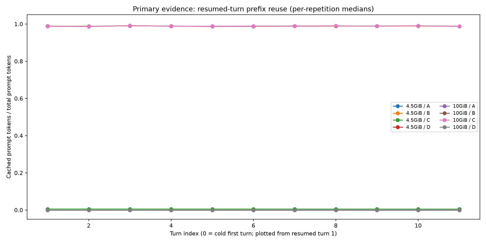
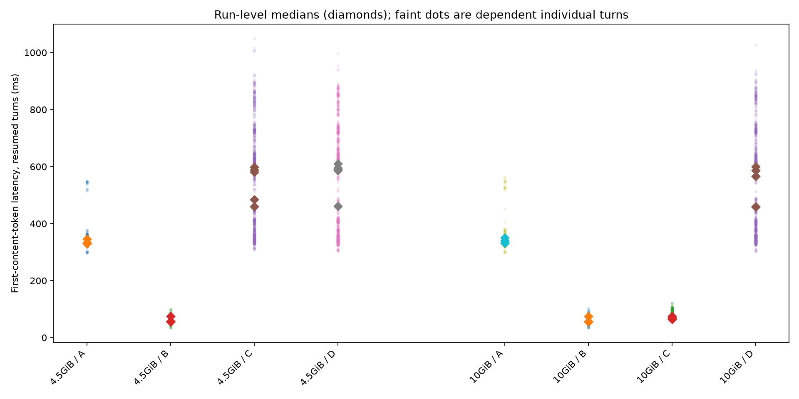
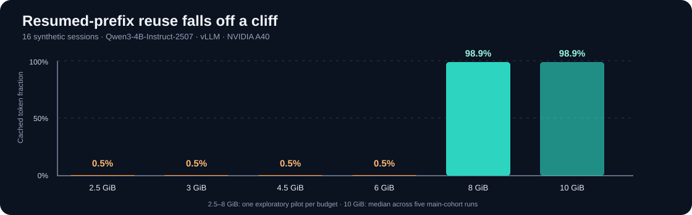

# Prefix-cache residency under multi-turn memory pressure

**Experiment:** 2026-10-12 · **Status:** completed real-GPU baseline · **Environment:** one RunPod NVIDIA A40, one model, one vLLM build.

## Question

When a multi-turn agent pauses between model calls, can the engine's automatic prefix cache preserve the session's reusable context while other sessions execute? How does answer change when the aggregate working set no longer fits the reserved KV memory?

## Findings

For this **deterministic 16-session cyclic workload**, useful prefix reuse nearly vanished at a 4.5 GiB GPU KV budget, despite the cache being large enough for the active in-flight footprint. A 10 GiB budget allowed almost all resumed prompt tokens to be reused.

| Metric (16 sessions) | Cache ON, 4.5 GiB | Cache OFF, 4.5 GiB | Cache ON, 10 GiB | Cache OFF, 10 GiB |
|:--|--:|--:|--:|--:|
| Median resumed cached-token fraction | **0.005** | 0 | **0.989** | 0 |
| Median resumed first-content-token latency | **581 ms** | 591 ms | **67 ms** | 567 ms |
| Computed prefill tokens | **614,668** | 617,724 | **54,956** | 617,724 |
| Run wall time | **80.1 s** | 80.3 s | **33.7 s** | 80.4 s |

Each cell reports the median of **five per-run results** (the TTFT value is the median of the per-run median resumed latencies). The tight-budget comparison had one repetition with an approximately 18% lower resumed-turn latency for cache ON, but no consistent wall-time benefit across repetitions. It would be inaccurate to call these two arms equivalent on every metric or every run.





## Reproduction conditions

| Component | Recorded configuration |
|:--|:--|
| Hardware | 1× NVIDIA A40 (46 GiB reported), RunPod on-demand, same host for all runs |
| Driver | 570.211.01 |
| Engine | vLLM 0.31.0+cu129; Python 3.12; torch 2.13.0+cu129 |
| Model | `Qwen/Qwen3-4B-Instruct-2507`, BF16 |
| Model and tokenizer revision | `cdbee75f17c01a7cc42f958dc650907174af0554` |
| Model context limit | 8192 tokens |
| Memory budgets | 4.5 GiB and 10 GiB, specified with `--kv-cache-memory-bytes` |
| Replay | 12 turns/session, append-only scripted history, 0.5 s tool pauses, 32 max output tokens, temperature 0 |
| Short workload | 4 sessions, maximum 2 in flight |
| Pressured workload | 16 sessions, maximum 4 in flight |
| Isolation | New server per arm and repetition; disjoint warm-up; within-repetition shuffled budget/arm order |

The recorded prompt-token range was approximately **2,964–3,405 tokens**; each synthetic session uses its own deterministic document. With 16 sessions, the overall prefix working set was about 54K tokens. Four simultaneously active prompts require much less memory, so the experiment could show lost **idle prefix residency without active-request preemption**.

The main cohort contains **40 runs**: 2 KV budgets × 4 configurations × 5 repetitions. Per repetition and budget, the four configurations contain 48 + 48 + 192 + 192 = **480 requests**, so there are **4,800 successful main-cohort requests total**. The reported preemption count was zero across the cohort.

The preregistered hypotheses, thresholds and cohort-restart rule are preserved in [the dated preregistration](protocols/cache-residency-2026-10-12.md). One attempted cohort aborted after four runs because of write problems on a RunPod network filesystem; the full cohort was restarted on local disk, as specified, and the original partial run is not part of the published observations.

## Memory-budget scan

A preceding **single-repetition** pilot of the 16-session cache-on configuration produced:

| GPU KV budget | Reported KV token slots | Median resumed cached-token fraction |
|--:|--:|--:|
| 2.5 GiB | 18,192 | 0.005 |
| 3 GiB | 21,840 | 0.005 |
| 4.5 GiB | 32,768 | 0.005 |
| 6 GiB | 43,680 | 0.005 |
| 8 GiB | 58,240 | 0.989 |
| 10 GiB | 72,816 | 0.989 (main-cohort measurement) |

The pilot brackets a pronounced transition between **6 GiB and 8 GiB**. The 10 GiB value comes from the main cohort, not that pilot. This transition is not an inferred universal threshold.



## What the data support

**Direct observations:** very low resumed cached-token fractions at the tight budget; almost complete reuse at the roomy budget; a large change in computed prefill tokens and completion time; no reported preemptions; stable repeated workload fingerprints.

**Plausible mechanism:** paused sessions leave cached blocks reclaimable, and competing prefixes displace them in an approximate cyclic/LRU pattern. A 16-session working set exceeding the available pool can lead to disproportionately low reuse. We did **not** record every KV block's eviction event, so the precise victim ordering is inferred rather than demonstrated.

**What this is not:** evidence that all production agent traffic thrashes in this way, that every cache policy behaves identically, or that routing/retention changes would necessarily improve outcomes.

## Experimental limits

- One A40, one model, one runtime build, and one host; results have no cross-hardware validation.
- Five repeated runs use the **same deterministic workload**, not five independent user/agent populations.
- The prompt schedule is synthetic and closed-loop. The client semaphore limits admission, and the first-turn burst differs from live agent arrivals.
- Client-perceived TTFT is measured to the first streamed content chunk, rather than the engine's internal TTFT timestamp.
- Some pressured-run latency measurements were bimodal and remain unexplained.
- No direct eviction-event timeline or system-level power/cost measurements were collected.
- The 3,000 ms goodput SLO was illustrative and is not a production SLA.

## Inspect the source data

```bash
python -m pip install -r requirements.txt
python scripts/evaluate_preregistration.py results/2026-10-12-runpod-a40/main
python scripts/summarize_pilot_scan.py results/2026-10-12-runpod-a40/pilot-scan
python scripts/summarize_ab_pilot.py results/2026-10-12-runpod-a40/ab-pilot
```

The [main-cohort artifacts](../results/2026-10-12-runpod-a40/main/) retain per-request `requests.jsonl`, before/after Prometheus scrapes, server logs, GPU setup manifests and derived CSV/plots. One-second metric time series were not committed.

See [benchmark methodology](cache-residency-methodology.md) for safe reproduction. For an explicitly **unmeasured** multi-replica extension, see [distributed routing study](routing-methodology.md).
