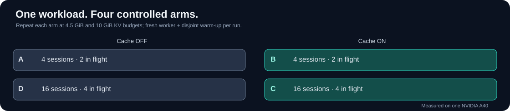

# Single-worker benchmark methodology

This document explains how to reproduce the **measured vLLM prefix-cache pressure baseline**, and how to distinguish a cache-residency effect from unrelated concurrency and queueing effects.

> The original data were collected on a specific RunPod A40 and vLLM CUDA build. Commands below are a reproducibility starting point, **not** a promise that the recorded wheels will work on any rented GPU.

## Experiment structure

The workload uses deterministic, session-specific prompts with repeated prefixes and paused tool-like turns. The matrix holds the workload, model and GPU fixed while changing only two controlled factors: prefix caching and concurrency, repeated under chosen explicit GPU KV budgets.

| Arm | Prefix caching | Sessions | Max in flight |
|---|---|---:|---:|
| A | OFF | 4 | 2 |
| B | ON | 4 | 2 |
| C | ON | 16 | 4 |
| D | OFF | 16 | 4 |

Each session has 12 turns, scripted append-only history, 0.5-second pauses and a 32-token output cap. The pause is **outside** the global in-flight semaphore. No new routing or eviction mechanism is enabled.



## Environment and version lock

Use an on-demand NVIDIA GPU host that supports your selected CUDA and vLLM build. Run the traffic client **inside the same host** at `127.0.0.1`, not through an external gateway. Do not compare runs from different GPU models, hosts or vLLM builds as though they are matched.

The exact source model revision is recorded in [env/env.sh](../env/env.sh), and the original CUDA/torchcodec workaround in [env/runpod_setup.sh](../env/runpod_setup.sh). The setup script was consolidated after the original interactive setup and **has not been validated end-to-end as one installer**.

```bash
git clone https://github.com/dundysm/inference-under-pressure.git
cd inference-under-pressure
python -m pip install -r requirements.txt
python -m unittest discover -s tests
DRY_RUN=1 REPS=2 bash scripts/run_baseline.sh
```

On a compatible GPU host, activate the tested environment or your own pinned replacement and verify:

```bash
nvidia-smi
vllm --version
vllm serve --help | grep -E 'kv-cache-memory-bytes|prompt-tokens-details|prefix-caching'
```

Before running a long sweep, ensure the endpoint returns health, captures the final streaming usage chunk, reports cached prompt tokens where supported, and that the server startup log reports a usable KV allocation.

## Pilot and full cohort

1. **Choose a safe KV budget.** The pool must fit at least one full model-context allocation required by the pinned runtime. Record actual KV blocks/tokens reported at startup; don't assume identical capacity from GiB across models or GPUs.
2. **Run a short sanity pilot.** Check that cold turns begin without measured-prefix warm-up contamination and that cache-on low-concurrency turns reuse their session prefixes.
3. **Run an exploratory budget scan.** For the pressured cache-on arm C, test several budgets before fixing the final study arms. Make the exploratory/pilot origin of budget selection explicit.
4. **Freeze the planned comparison** before the main cohort. The original study's frozen protocol is in [preregistration-main-2026-10-12.md](protocols/cache-residency-2026-10-12.md).
5. **Interleave arms and budgets** within each repetition. Restart the server between runs, wait for the GPU to return close to its initial memory baseline, and use a disjoint warm-up session namespace.
6. **Store raw evidence first:** request JSONL, server log, startup KV allocation, environment freeze, Prometheus before/after snapshots and a model-revision lock.

The recorded primary cohort used budgets `4831838208` (4.5 GiB) and `10737418240` (10 GiB):

```bash
# In a pinned, compatible GPU environment:
source env/env.sh
RESULTS_DIR=/root/results/new-cohort ARMS=ABCD REPS=5 PREFETCH_MODEL=0 \
  KV_BUDGETS="4831838208 10737418240" \
  bash scripts/run_baseline.sh

python scripts/analyze.py --results /root/results/new-cohort --slo-ms 3000
```

Use a **new results directory** for every run; never overwrite historical evidence. Write active logs locally; on the original RunPod setup, writes to `/workspace` were unreliable.

## Interpreting the metrics

- **Primary cache evidence:** `cached_tokens / prompt_tokens` on resumed turns (turn index ≥ 1), plus computed-prefill-token counter deltas.
- **Performance:** client-observed first-content-token latency and workload wall time; report harness admission waiting separately.
- **Secondary diagnostics:** cache usage gauge, queue depth, active preemptions and rate of failed requests.
- **Counter hygiene:** subtract Prometheus counters sampled within the same server lifetime; a histogram `_sum` is not its p95.
- **Statistics:** summarize each repetition, then compare matched cache ON/OFF arms. Individual turns in the same session are dependent.

A cache miss with zero reported preemptions is possible: blocks from paused, completed requests can be reclaimed without preempting any running request. Conversely, low measured occupancy alone does not prove absence of cache pressure.

## Validation and boundaries

The results are valid for the exact tested configuration, not a generalized agent-workload benchmark. A new host or runtime needs a new calibration. Do not infer per-block eviction decisions without KV event instrumentation; do not call a negative measurement "equivalence" without an appropriately powered equivalence test.

See [full measurements and limitations](cache-residency-findings.md).
