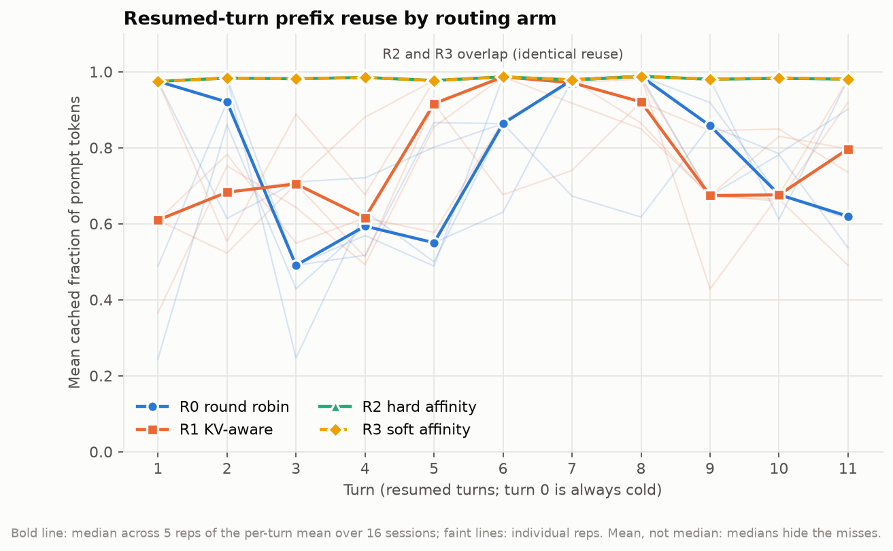
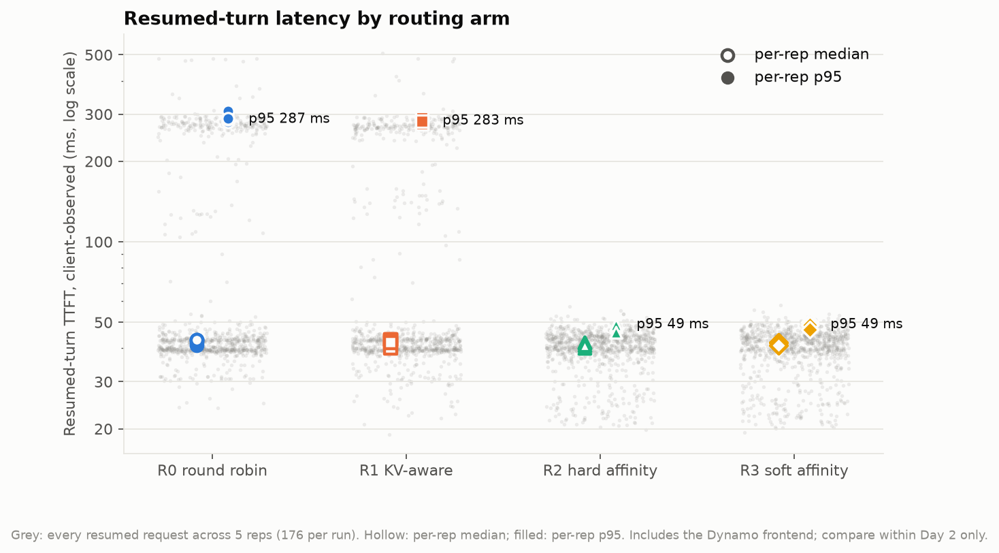
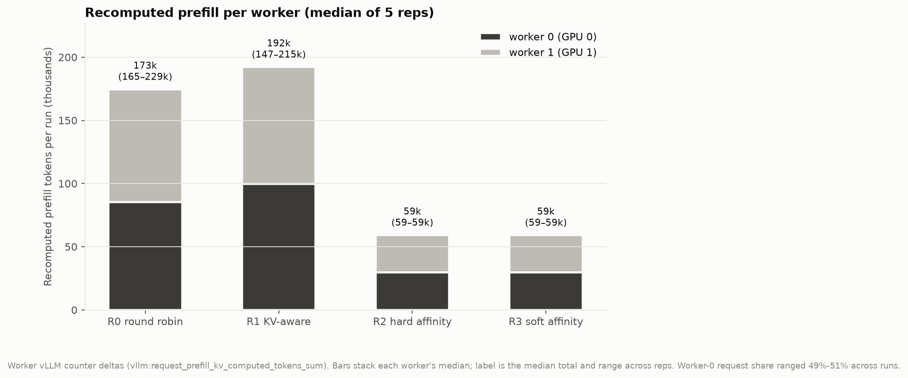
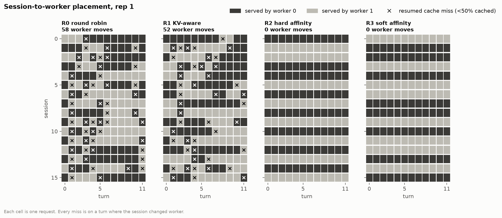
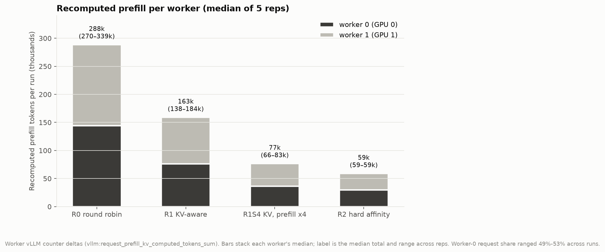
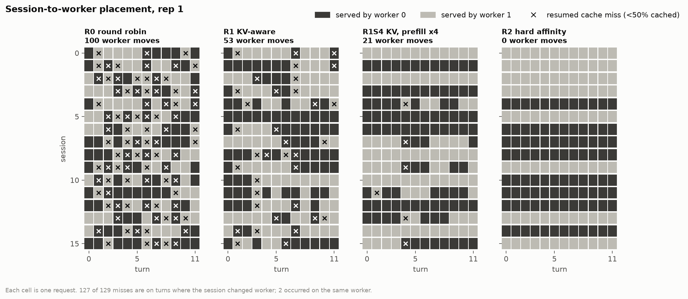

# Distributed routing: experimental findings

**Date:** 2026-10-12. **Status:** complete.
- **Main cohort:** five pre-registered repetitions on two GPUs ([pre-registration](protocols/routing-primary-2026-10-12.md)).
- **Diagnostic and exploratory runs:** one and two respectively, outside the cohort and labelled as such.
- **Pre-registered follow-up cohorts:** sensitivity and supplementary ([pre-registration](protocols/routing-sensitivity-2026-10-12.md)); see [Follow-up cohorts](#follow-up-cohorts).

## Question
On the **same two GPUs** with the **same 4.5 GiB KV pool per worker**, how much does the request router change prefix reuse, recomputation, latency and load balance for the cache-residency baseline's 16-session agent-like workload?

## Answer
**Placement decides almost everything, and session affinity was the best placement in every regime tested.** The default-weighted KV-aware router recovered **none** of the locality on the synchronized workload and **about half** of it on a staggered, heavier one.

- **Session affinity (hard or soft):**
  - **Main cohort:** recomputes **0.26–0.36×** round robin's prefill and cuts resumed p95 TTFT from about 280–310 ms to **46–50 ms**, with perfectly balanced workers.
  - **Sensitivity cohort** (staggered starts, variable pauses, 8 in flight): **0.17–0.22×**, still balanced.
- **The KV-aware router at default weights (R1):**
  - **Main cohort (synchronized):** indistinguishable from round robin. It beat round robin in only **3 of 5** reps; median 0.88×, range 0.77–1.24×.
  - **Sensitivity cohort:** **0.51×** round robin, a real improvement but still about 2.4× affinity's recompute.
  - The claim "no better than round robin" holds only for the synchronized pattern.
- **Where the misses come from:**
  - **Main cohort:** all **397/397** resumed cache misses in the non-affinity arms happened on a turn where the session had moved worker.
  - **Sensitivity cohort:** **524/533** did. The other 9 were same-worker evictions under 8 in flight.
- **Diagnosis, from debug router logs:** the router's KV index was accurate. It moved sessions away from the worker it correctly believed held their prefix, because its default weighting priced momentary load on that worker above the reuse.
- **Raising `--router-prefill-load-scale` to 4:**
  - Exploratory runs on the synchronized workload: reproduced hard affinity token for token, on both GPU types.
  - Pre-registered sensitivity cohort: cut recompute from 0.51× to **0.26×** round robin, with p95 within 1.09× of affinity. It still recomputed **1.30×** affinity (S-H3 not supported).
- **Capacity controls:**
  - One worker with 4.5 GiB reproduces the cache-residency baseline's total collapse on the distributed routing study stack: 0.000 cached, 10.4× recompute.
  - One worker with the pooled 9 GiB reuses exactly as well as two affinity-routed 4.5 GiB workers. The second GPU buys about 12% wall time.

## Setup
- **Hardware:** RunPod on-demand pod, 2× NVIDIA RTX PRO 4500 Blackwell Server Edition (32 GB, same NUMA node), driver 580.178.04, CUDA 13.0.
  - GPU 1 carried 5,691 MiB that did not belong to this experiment. It was invisible from the container and sat at 0% utilization beforehand. It was recorded as a baseline in every manifest, and utilization was sampled during each run.
- **Software:** Dynamo `ai-dynamo==1.5.1` (git `2093662a`), vLLM 0.28.0, torch 2.13.0+cu130.
  - Discovery is file-based, requests travel over TCP and KV events over ZMQ; there is no etcd or NATS.
- **Workers:** one per GPU, identical in every arm.
  - `--block-size 64 --max-model-len 8192 --kv-cache-memory-bytes 4831838208` (32,768 tokens each), prefix caching on, KV events on.
  - `PYTHONHASHSEED=0`, `--gpu-memory-utilization 0.70`. This only affects vLLM's startup free-memory check.
  - `VLLM_USE_FLASHINFER_SAMPLER=0`. The FlashInfer sampler cannot JIT-compile for sm_120 on this image. Decoding is greedy either way.
- **Workload:** the cache-residency baseline's workload exactly. The prompt digest is `c9c7e42687f3…` in every run.
  - 16 sessions × 12 turns, about 3–3.4K-token prompts, a 0.5 s tool pause, 4 requests in flight, 32 output tokens.
  - A stable `X-Dynamo-Session-ID` is sent on every turn in all arms.
- **Placement:** recorded per request from Dynamo's `nvext.worker_id`, and mapped to GPUs from each worker's log.
  - It was corroborated by the per-worker vLLM counters.
  - It was known for **every one of the 3,840 main-cohort requests**.

| Arm | Frontend |
|---|---|
| R0 | `--router-mode round-robin` |
| R1 | `--router-mode kv` (default weights) |
| R2 | round robin plus hard session affinity (TTL 300 s) |
| R3 | KV plus soft session affinity (TTL 300 s) |

## Results (main cohort)
- **Validity:** 5 reps × 4 arms, all 20 runs valid. 192/192 requests per run, placement known 192/192, the same prompt digest everywhere, and **zero preemptions**. Each run used a fresh cluster in seeded order.

Per repetition, recomputed prefill relative to R0, then resumed p95 TTFT and wall time:

| Rep | R0 | R1 | R2 | R3 |
|---|---|---|---|---|
| 1 | 1.00× · 309 ms · 28.2 s | 0.88× · 276 ms · 26.7 s | 0.26× · 48 ms · 22.0 s | 0.26× · 49 ms · 21.9 s |
| 2 | 1.00× · 280 ms · 27.1 s | 0.77× · 276 ms · 25.1 s | 0.29× · 49 ms · 21.9 s | 0.29× · 50 ms · 21.9 s |
| 3 | 1.00× · 280 ms · 25.8 s | **1.17×** · 288 ms · 26.6 s | 0.36× · 49 ms · 21.9 s | 0.36× · 49 ms · 22.1 s |
| 4 | 1.00× · 287 ms · 26.0 s | **1.24×** · 290 ms · 27.3 s | 0.34× · 49 ms · 21.8 s | 0.34× · 49 ms · 22.0 s |
| 5 | 1.00× · 289 ms · 26.1 s | 0.86× · 283 ms · 25.0 s | 0.35× · 46 ms · 21.9 s | 0.35× · 47 ms · 21.8 s |

Pre-registered hypotheses (full output in [`hypotheses.txt`](../results/2026-10-12-runpod-2x-rtxpro4500/day2-main/hypotheses.txt)):

| | Claim | Result |
|---|---|---|
| H1 | Affinity: prefill and p95 below 0.5× R0 in every rep | **Supported** |
| H2 | KV router below R0 in ≥4/5 reps but above 2× R2 | **Not supported**: below R0 in only 3/5 reps (median R1/R2 = 3.25×) |
| H3 | ≥90% of misses on worker moves | **Supported**: 397/397 |
| H4 | Soft ≈ hard affinity (±10%), balanced split | **Supported**: R3/R2 = 0.999 |
| H5 | No balance penalty for affinity (R2 wall ≤ R0) | **Supported** in every rep |

### Figures (main cohort)

The figures are generated by [`scripts/routing_plots.py`](../scripts/routing_plots.py) from the committed raw data.

### Table A: paired comparison against R0
Each value is computed per rep, then summarized as the median with [min, max] across reps.

| Arm vs R0 | Recomputed prefill | Resumed p95 | Resumed median TTFT Δ (ms) | Resumed mean cached fraction Δ | Wall | Goodput @ 3 s |
|---|---|---|---|---|---|---|
| R1 KV-aware | 0.88× [0.77×, 1.24×] | 0.99× [0.89×, 1.03×] | +0 [−3, +2] | +0.042 [−0.076, +0.085] | 0.96× [0.93×, 1.05×] | 1.04× [0.95×, 1.08×] |
| R2 hard affinity | 0.34× [0.26×, 0.36×] | 0.17× [0.16×, 0.17×] | −1 [−3, +1] | +0.199 [+0.187, +0.301] | 0.84× [0.78×, 0.85×] | 1.19× [1.18×, 1.29×] |
| R3 soft affinity | 0.34× [0.26×, 0.36×] | 0.17× [0.16×, 0.18×] | −1 [−2, +1] | +0.199 [+0.187, +0.301] | 0.84× [0.78×, 0.86×] | 1.19× [1.17×, 1.29×] |

- **R0 baseline:** R0's own resumed mean cached fraction is 0.782 (median of reps).
- **Paired ratio vs ratio of medians:** R1's paired prefill ratio is 0.88×, but its *median total* (192k) is above R0's (173k) in the prefill figure. Both statements are true. R0's totals vary widely across reps (165–229k), so the median of per-rep ratios and the ratio of medians point in different directions. The defensible summary is that **R1 is indistinguishable from R0**, not that it is slightly better.
- **Table B (validity):** one row per run, in [`tables.md`](../results/2026-10-12-runpod-2x-rtxpro4500/day2-main/analysis/tables.md).
  - Every run: 192/192 requests OK and placement known, digest `c9c7e42687f3`, 0/0 preemptions, 32,768/32,768 KV tokens on both workers, and 176/176 cached-token coverage.
  - Requests split 95–97 per worker.
  - Mean worker queue time was ≤0.1 ms in every run.

**The median resumed cached fraction is misleading here.** It is about 0.97–0.98 in every arm, R0 included, because most resumed turns still hit. Recomputed prefill and p95 expose the roughly one-third of R0 turns that missed. That is why the pre-registration made recomputation and p95 primary.

## Mechanism

### Misses are moves
In every arm, a resumed turn served by the same worker as the previous turn hit the cache, with no exceptions. A move to the other worker almost always missed (pilot: mean cached fraction 0.12–0.18 on moves). Each worker's own cache was big enough for the sessions that stayed on it, so the cost came entirely from where requests were sent.

### Why the KV router moved sessions (diagnostic run, untimed)
One R1 run used `DYN_LOG=info,dynamo_kv_router=debug`, joined per request to the router's per-worker cost formula using the response id. [`scripts/routing_diagnose.py`](../scripts/routing_diagnose.py) does the join.
- **On the 135 stays,** the router believed 50 cached blocks on the serving worker, and 50 were actually cached.
- **On the 41 moves,** the router believed the *previous* worker still held a median of **49 of about 50 blocks**, and the destination 0. The destination indeed had 0.
  - Moves away from a worker the router knew held the prefix: **41/41**.
  - Stale-index mispredictions: **0/41**.
  - Moves caused by eviction from both workers: **0/41**.
- **The cost formula** is `logit = prefill_load_scale × max(0, raw_prefill − overlap_credit) + decode_blocks + active`.
  - The overlap credit offsets only the prefill term, so it is worth at most the request's own prefill (about 47 blocks).
  - A worker with one extra in-flight sequence (about 48 decode blocks), or another request's queued prefill (about 50 blocks), therefore ties or beats the reuse.

Example (session 0, turn 2):

| Worker | Prefill term | Decode term | Logit |
|---|---:|---:|---:|
| Worker with the prefix | 1.25 | 143 | 144.25 |
| Empty worker (chosen) | 47.25 | 95 | **142.25** |

With 32-token outputs, that decode load drains in tens of milliseconds, while recomputing a 3K-token prefix costs about 300 ms. The default weighting makes the wrong trade for this long-prefix, short-output, pause-heavy pattern.

The workers' own scheduler queue time supports this. `vllm:request_queue_time_seconds` averaged **≤0.1 ms in every run of every arm**, including the affinity arms that never moved a session. The load the router steered away from never became measurable queueing on these workers; concurrent prefills were batched by chunked prefill.

### Causal check (exploratory, one run each, not pre-registered)

| R1 `--router-prefill-load-scale` | Moves | Sessions kept on one worker | Recomputed prefill | Resumed p95 | Wall |
|---|---:|---:|---:|---:|---:|
| 1 (default; pilot) | 50 | 2/16 | 187,772 | 287 ms | 26.5 s |
| 2 | 6 | 12/16 | 73,148 | 49 ms | 22.2 s |
| 4 | **0** | **16/16** | **59,196** | 50 ms | 21.9 s |
| *R2 hard affinity (pilot), for reference* | 0 | 16/16 | 59,196 | 48 ms | 21.8 s |

## Follow-up cohorts
Pre-registered in [routing-sensitivity-2026-10-12.md](protocols/routing-sensitivity-2026-10-12.md) before any follow-up run. Both cohorts ran on a **new pod with 2× NVIDIA L40S** (48 GB, driver 580.126.09, CUDA 13.0, no foreign GPU memory), because the RTX PRO 4500 pair was sold out. Everything else was identical:
- the KV budget (4.5 GiB, 32,768 tokens per worker), model, Dynamo/vLLM build and prompts (digest `c9c7e42687f3`);
- R0–R3 launch arguments, byte-identical to the main cohort.

Results are compared **within each cohort only**. All 32 runs were valid: 192/192 requests, placement known for every request, and the expected digest. Raw data: [`results/2026-10-12-runpod-2x-l40s/`](../results/2026-10-12-runpod-2x-l40s/).

**Smoke check** (one run each, outside the cohorts): on the L40S pair, R1S4 on the fixed workload again made 0 moves and recomputed exactly 59,196 tokens. So the exploratory "prefill-scale 4 matches affinity" result reproduces on a second GPU type.

### Cohort S: sensitivity
The workload was changed to:
- staggered session starts (seeded 0–8 s);
- seeded variable tool pauses (0.25–1.75 s, mean about 1 s);
- **8** requests in flight.

The schedule is identical across arms and reps, so comparisons are paired. 5 reps × 4 arms.

| Arm (median across 5 reps) | Recomputed prefill | vs R0 | Resumed p95 | Resumed mean cached | Wall |
|---|---:|---:|---:|---:|---:|
| R0 round robin | 288k | 1.00× | 229 ms | 0.579 | 26.2 s |
| R1 KV, default weights | 163k | **0.51×** | 187 ms | 0.797 | 25.1 s |
| R1S4 KV, `--router-prefill-load-scale 4` | 77k | **0.26×** | 61 ms | 0.950 | 24.4 s |
| R2 hard affinity | 59k | **0.21×** | 56 ms | 0.982 | 24.3 s |

Full per-rep output is in [`hypotheses.txt`](../results/2026-10-12-runpod-2x-l40s/day2-sens/hypotheses.txt), and the paired Table A and validity Table B are in [`tables.md`](../results/2026-10-12-runpod-2x-l40s/day2-sens/analysis/tables.md).

| | Claim | Result |
|---|---|---|
| S-H1 | Affinity recompute < 0.5× R0, every rep | **Supported** (0.17–0.22×) |
| S-H2 | Default KV router still ≈ round robin (median R1/R0 ≥ 0.75) | **Not supported**: 0.51× |
| S-H3 | Prefill-scale 4 within 1.2× of affinity on recompute | **Not supported**: 1.30× |
| S-H4 | Prefill-scale 4 p95 within 1.2× of affinity | **Supported** (1.09×) |
| S-H5 | ≥90% of misses on worker moves (R0, R1) | **Supported**: 524/533 (98.3%) |
| S-H6 | Affinity balanced (40–60% per worker) | **Supported**: exactly 50% every rep |

What this changes:
- **The default KV router is workload-dependent, not useless.** When sessions are synchronized, every resumed turn arrives while its sibling sessions' prefills and decodes load the cache-holding worker, so the load term wins every time. With staggered arrivals, the cache-holding worker is more often lightly loaded at decision time, so overlap wins more often.
- **The reweighting helps a lot but does not fully close the gap.** It still made 21 moves in rep 1 versus affinity's 0.
- **Affinity is still best.** Under this schedule it was also never worse on tail latency or balance.
- **Same-worker misses appear under load.** The 9 non-move misses are same-worker evictions that appear only at 8 in flight, which pushes more active blocks through each 32,768-token pool.

The other two sensitivity figures (reuse by turn, resumed TTFT) are in the same [`analysis/`](../results/2026-10-12-runpod-2x-l40s/day2-sens/analysis/) folder.

### Cohort X: supplementary (fixed workload)
Same timing as the main cohort. 3 reps × 4 arms.

| Arm (median across 3 reps) | Workers × KV | Recomputed prefill vs R2 | Resumed mean cached | Resumed p95 | Wall |
|---|---|---:|---:|---:|---:|
| R2 hard affinity (round-robin base) | 2 × 4.5 GiB | 1.00× | 0.982 | 48 ms | 21.8 s |
| R3H hard affinity (KV base; the guide's R3) | 2 × 4.5 GiB | 1.00× | 0.982 | 50 ms | 22.0 s |
| S45 single worker | 1 × 4.5 GiB | **10.44×** | **0.000** | 338 ms | 48.9 s |
| S9 single worker | 1 × 9 GiB | **1.00×** | 0.982 | 49 ms | 24.7 s |

| | Claim | Result |
|---|---|---|
| X-H1 | The guide's R3 (KV + hard) ≈ R2 | **Supported** (1.000×) |
| X-H2 | the cache-residency baseline collapse reproduces on the distributed routing study stack | **Supported** (0.000 cached every rep) |
| X-H3 | One 9 GiB worker fits the working set | **Supported** (0.982 cached; recompute = R2) |
| X-H4 | Two GPUs finish sooner than one 9 GiB GPU | **Supported** (21.8 s vs 24.7 s every rep) |

What this adds:
- **The cache-residency baseline cliff is a property of the KV budget versus the working set, not of vLLM 0.31 or the block size.**
  - The cached fraction is exactly 0.000 here, where the cache-residency baseline had 0.005. With 64-token blocks, the short shared system prompt no longer fills a whole block.
- **Two GPUs at 4.5 GiB with affinity reuse exactly as well as one GPU holding all 9 GiB.** Partitioning the sessions loses nothing; the second GPU buys about 12% wall time.
- **Without affinity, two 4.5 GiB workers (main cohort R0/R1) do far worse than one 9 GiB worker.** The routing policy decides whether the memory is partitioned usefully.

## Predictions that were wrong
- **R0 collapse.** I expected round robin to collapse to the cache-residency baseline-style near-zero reuse. It did not: about two thirds of resumed turns still hit, because round robin scrambles the strict cyclic order that defeated LRU on the cache-residency baseline. Its cost showed up as about 4× the recompute and about 6× the p95, not as a near-zero hit rate.
- **R1 cause.** I attributed R1's moves to eviction or a stale index before the diagnostic run. Both were ruled out; the cause is the cost weighting.
- **S-H2: R1 stays like round robin.** I expected the default KV router to stay like round robin under a varied schedule. It halved round robin's recompute.
- **S-H3: the reweighting matches affinity.** I expected prefill-scale 4 to match affinity under the varied schedule, as it did in the synchronized exploratory runs. It recomputed 1.30× affinity.

## Limitations
- **Scope:** one model, one prompt set and two timing patterns; one Dynamo/vLLM build; RunPod single-host pods.
  - The workload is synthetic and client-throttled (4 or 8 in flight).
  - It is still light enough that the workers' scheduler queues stayed near empty. A heavier or skewed workload could reward the load term that R1 weights.
- **GPU types differ between cohorts.** The main and follow-up cohorts ran on different GPU types (RTX PRO 4500 vs L40S). No cross-cohort latency comparison is made.
- **Exploratory evidence:** the prefill-load-scale 2/4 results on the synchronized workload are single exploratory runs. The sensitivity cohort is the pre-registered test of the reweighting.
- **Host asymmetry (main cohort only):** GPU 1's foreign 5.7 GiB allocation on the main-cohort pod is an unexplained asymmetry. Per-worker results there were symmetric, and the L40S pod had none.
- **TTFT definition:** client TTFT is measured to the first streamed content and includes the Dynamo frontend.

## Reproduce
- **Launcher:** [`scripts/routing_cluster.sh`](../scripts/routing_cluster.sh) holds all worker and frontend flags for every arm, including R1S4, R3H, S45 and S9.
- **Cohorts:** [`scripts/routing_run_matrix.sh`](../scripts/routing_run_matrix.sh) runs them, for example:
  - `COHORT=main REPS=5`
  - `COHORT=sens ARMS="R0 R1 R1S4 R2" REPS=5 STAGGER_S=8 PAUSE=0.25 PAUSE_MAX=1.75 MAX_INFLIGHT=8`
  - `COHORT=supp ARMS="R2 R3H S45 S9" REPS=3`
- **Environment:** [`env/runpod_routing_setup.sh`](../env/runpod_routing_setup.sh). It ran unmodified on the follow-up pod.
- **Analysis:**
  - [`scripts/routing_evaluate.py`](../scripts/routing_evaluate.py) evaluates the main cohort and [`scripts/routing_followup_evaluate.py`](../scripts/routing_followup_evaluate.py) the follow-up cohorts.
  - [`scripts/routing_analyze.py`](../scripts/routing_analyze.py) produces per-run summaries.
  - [`scripts/routing_plots.py`](../scripts/routing_plots.py) builds figures and Tables A/B; pass the arm list as a third argument, e.g. `R0,R1,R1S4,R2`.
  - [`scripts/routing_diagnose.py`](../scripts/routing_diagnose.py) does the debug-log join and needs `DYN_LOG=info,dynamo_kv_router=debug`.
- **Raw data:**
  - [`results/2026-10-12-runpod-2x-rtxpro4500/`](../results/2026-10-12-runpod-2x-rtxpro4500/): pilot, main, diagnostic and exploratory runs.
  - [`results/2026-10-12-runpod-2x-l40s/`](../results/2026-10-12-runpod-2x-l40s/): smoke runs, sensitivity and supplementary cohorts, setup and runner logs.

## Next
**Upstream issue: filed as [ai-dynamo/dynamo#16194](https://github.com/ai-dynamo/dynamo/issues/16194).** It reports to Dynamo, scoped by both cohorts, that under default weights the KV router knowingly trades cached-prefix reuse for transient load:
- On synchronized multi-turn traffic this erases all locality.
- On staggered traffic it keeps about half.
- `--router-prefill-load-scale 4` recovers most but not all of the gap to session affinity.
- `non_max_overlap_selections_total` stays 0 throughout.

This is related to [ai-dynamo/dynamo#13279](https://github.com/ai-dynamo/dynamo/issues/13279).
